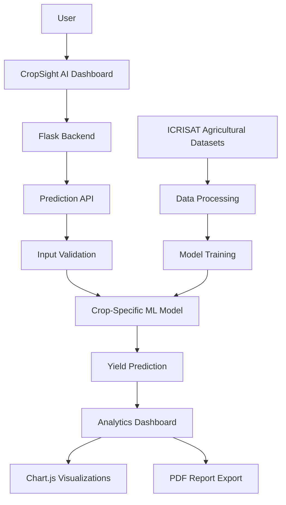

# 🌾 CropSight AI
### AI-Powered Crop Yield Prediction & Agricultural Intelligence Platform

<p align="center">
  **Predicting Agricultural Outcomes Through Machine Learning and Data Intelligence**
</p>

<p align="center">
  <a href="https://astrava-sooty.vercel.app">
    
  </a>
  
  
  
  
</p>

---

## 🌱 Overview

**CropSight AI** is an intelligent agricultural analytics platform that leverages Machine Learning to predict crop yields using historical district-level agricultural datasets from ICRISAT.

The platform transforms historical agricultural data into actionable insights through trained crop-specific prediction models, interactive visualizations, and multilingual analytics.

It enables users to explore crop productivity across different Indian states, districts, agricultural seasons, and years.

### 🎯 Project Highlights

| Capability | Description |
|---|---|
| 🤖 ML Models | 43 crop-specific trained prediction models |
| 🗺️ Geographic Analysis | State-wise and district-wise predictions |
| 🌦️ Seasonal Analysis | Kharif, Rabi, Summer and Whole Year |
| 📊 Data Visualization | Interactive analytical dashboards |
| 📈 Historical Insights | Crop yield trends and comparisons |
| 🌐 Multilingual UI | Multiple language support |
| 📄 Report Generation | Downloadable PDF reports |

---

## 🚀 Live Application

<p align="center">
  <a href="https://astrava-sooty.vercel.app">
    
  </a>
</p>

Explore the live dashboard:

🔗 https://astrava-sooty.vercel.app

---

## ✨ Key Features

### 1. 🤖 Machine Learning-Based Prediction
- 43 crop-specific prediction models where sufficient training data is available.
- Trained using historical agricultural datasets.
- Crop yield prediction based on selected geographic and seasonal parameters.
- Model validation metrics available through the application.

### 2. 🗺️ Geographic Intelligence
- Dynamic state selection.
- District selection based on available dataset values.
- District-level agricultural analysis.
- Crop-specific historical statistics.

### 3. 📊 Interactive Analytics Dashboard

Explore multiple analytical chart sheets:

| Visualization | Purpose |
|---|---|
| 📈 Historical Trends | Analyze crop yield patterns over time |
| 📉 Confidence Intervals | Examine prediction uncertainty |
| 🌾 Crop Comparison | Compare productivity across crops |
| 🌦️ Season Comparison | Analyze seasonal yield differences |
| 🌱 Growing Conditions | Explore available growing-condition indicators |

### 4. 🌐 Multilingual Experience
- Multilingual dashboard labels.
- Improved accessibility for different users.

### 5. 📄 PDF Report Export
Generate downloadable reports containing prediction results and analytical insights.

---

## 🏗️ System Architecture



---

## 🧠 Technology Stack

| Technology | Usage |
|---|---|
| Python | Core programming language |
| Flask | Backend application and REST APIs |
| Scikit-learn | Machine Learning model development |
| Pandas & NumPy | Data processing and manipulation |
| Chart.js | Interactive data visualization |
| HTML5 & CSS3 | Dashboard interface |
| JavaScript | Frontend functionality |
| Joblib | Model artifact serialization |
| Gunicorn | Production application server |
| Vercel / Render | Deployment |

---

## 📂 Project Structure

```text
astrava/
│
├── app.py
│
├── train_model.py
│
├── requirements.txt
│
├── render.yaml
│
├── crop_yield_model.joblib
│
├── model_metrics.json
│
├── ICRISAT-District Level Data.csv
│
├── horizontal_crop_vertical_year_report.xls
│
├── templates/
│   └── index.html
│
└── static/
    ├── css/
    ├── js/
    └── images/
```

*Note: The structure above illustrates the main project files and a typical Flask frontend organization.*

---

## ⚙️ Installation & Setup

### Prerequisites

- Python 3.11 or newer
- Git
- VS Code (recommended)

### Step 1: Clone the Repository

```bash
git clone https://github.com/MAHANTHESHVINU/astrava.git
```

### Step 2: Navigate to the Project

```bash
cd astrava
```

### Step 3: Create a Virtual Environment

```powershell
python -m venv .venv
```

### Step 4: Activate the Environment

```powershell
.venv\Scripts\Activate.ps1
```

### Step 5: Install Dependencies

```bash
pip install -r requirements.txt
```

### Step 6: Launch the Application

```bash
python app.py
```

<p align="center">
  🌐 <b>Application URL:</b><br>
  http://127.0.0.1:5000
</p>

---

## 🔄 Model Training

To retrain the crop yield prediction models using the available agricultural datasets:

```bash
python train_model.py
```

The training process generates or updates the model artifacts.

```bash
python app.py
```

### Model Artifacts

| File | Description |
|---|---|
| `crop_yield_model.joblib` | Serialized trained model |
| `model_metrics.json` | Model validation metrics |

---

## 🔌 REST API Documentation

CropSight AI exposes REST API endpoints for dashboard integration and prediction requests.

| Method | Endpoint | Description |
|---|---|---|
| GET | `/` | Main dashboard |
| GET | `/health` | Application health and loaded model count |
| GET | `/api/catalog` | States, districts, crops, labels and statistics |
| POST | `/api/predict` | Generate crop yield prediction |
| GET | `/model_metrics.json` | Retrieve model validation metrics |

### Example Prediction Request

**Endpoint**

```http
POST /api/predict
Content-Type: application/json
```

**Request Body**

```json
{
  "crop": "rice",
  "state": "Karnataka",
  "district": "Dharwad",
  "year": 2024,
  "season": "Kharif"
}
```

**Response**

The API returns the prediction result and associated response information according to the application's implementation.

---

## 📊 Model Evaluation

Model validation metrics are maintained in:

```text
model_metrics.json
```

These metrics provide a reference for evaluating the trained prediction models.

The dashboard uses crop-specific models where sufficient historical data is available.

---

## ☁️ Deployment

### 🚀 Vercel Deployment

Live application:

https://astrava-sooty.vercel.app

Deploy your GitHub repository using:

[](https://vercel.com/new/clone?repository-url=https://github.com/MAHANTHESHVINU/astrava)

### ☁️ Render Deployment

1. Push the project to GitHub.
2. Open [Render Blueprints](https://dashboard.render.com/blueprints).
3. Select **New Blueprint**.
4. Connect your GitHub repository.
5. Render reads the `render.yaml` configuration.
6. Install dependencies from `requirements.txt`.
7. Start the application using:

```bash
gunicorn app:app
```

**Health Check Endpoint**

```text
/health
```

---

## 📚 Dataset Sources

CropSight AI uses historical agricultural datasets:

**1. ICRISAT District-Level Database**

- District-level agricultural statistics.
- Historical crop production information.
- Agricultural area and productivity indicators.

**2. Historical Crop Dataset**

- `horizontal_crop_vertical_year_report.xls`
- Crop-wise historical data across years.

---

## 🔮 Future Enhancements

Potential directions for extending the platform:

- 🛰️ Satellite-based vegetation analysis using Sentinel-2 imagery.
- 🌦️ Integration of real-time weather information.
- 🌱 Soil health and agricultural suitability analysis.
- 🗺️ Interactive district-level yield maps.
- 🤖 Advanced time-series forecasting models.
- 📡 Real-time agricultural intelligence.
- 📊 Advanced model explainability using SHAP.
- 📱 Mobile-friendly agricultural analytics.

---

## 🌍 Project Vision

> Turning agricultural data into intelligent decisions.

CropSight AI aims to bridge the gap between agricultural data and practical decision-making by combining Machine Learning, historical crop statistics, and interactive analytics.

The long-term vision is to build an intelligent agricultural decision-support platform that helps users understand crop productivity patterns and explore data-driven agricultural insights.

---

## 👨‍💻 Developer

**Vinumahanthesh G**

Artificial Intelligence & Machine Learning  
HKBK College of Engineering

<p align="left">
  <a href="https://github.com/MAHANTHESHVINU">
    
  </a>
</p>

---

<p align="center">
  🌾 <b>CropSight AI</b><br>
  <i>Intelligence for a More Productive Agricultural Future.</i>
</p>

<p align="center">
  ⭐ If you find this project interesting, consider starring the repository!
</p>
